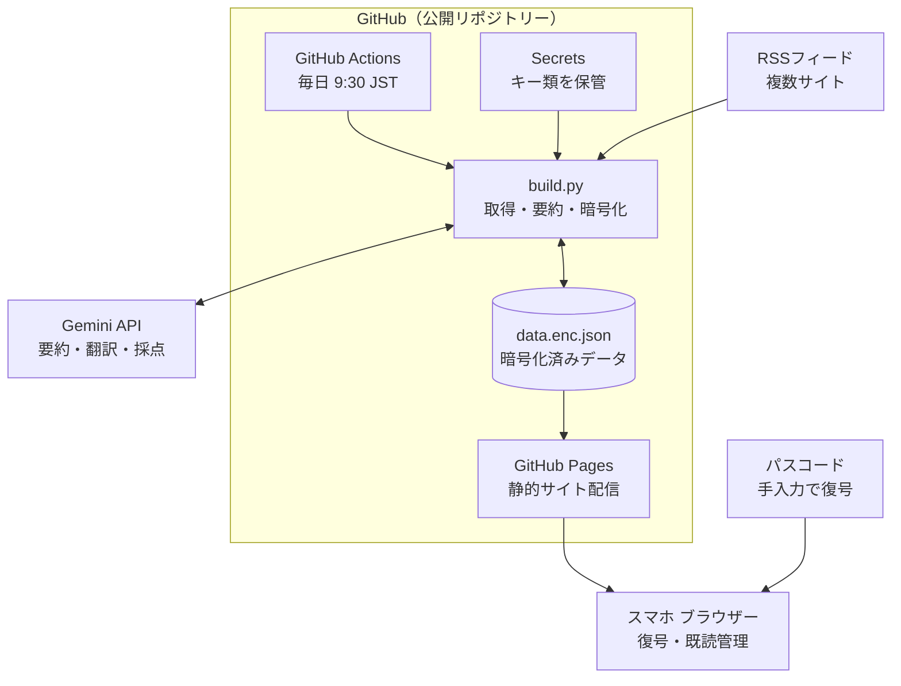

# 構築手順書: Tech Digest

完全無料で運用する「技術ニュースまとめアプリ(旧称 AI News Digest)」の初期構築手順です。設計判断、システム構成図、コード、作業手順、運用上の注意をまとめています。

> `docs/` は GitHub Pages で公開されるフォルダーです。この手順書は公開したくないため、リポジトリー直下に置いています。

## システム構成図



### データの流れ

| # | 処理 | 担当 |
|---|---|---|
| 1 | 毎日 9:30 JST(UTC 00:30)に起動 | GitHub Actions |
| 2 | RSS から新着記事を取得し、既存の `data.enc.json` を復号して重複を除外 | build.py |
| 3 | `batch_size` 件ずつ Gemini に送り、日本語要約・翻訳・星(1〜5)・重複判定を取得 | build.py → Gemini API |
| 4 | 全記事を AES-GCM で再暗号化して `data.enc.json` に書き込み、コミット | build.py |
| 5 | `docs/` を GitHub Pages にデプロイ | GitHub Actions |
| 6 | スマホでパスコードを入力すると、ブラウザー内で復号して表示。既読は localStorage に保存 | ブラウザー |

- Secrets(`GEMINI_API_KEY` と `APP_PASSCODE`)は Actions 内でのみ参照され、公開リポジトリーには含まれません。
- 公開されるのは暗号文のみです。パスコードを持たない第三者は記事内容を読めません。

## 1. 設計上の重要事項

`[仮定: リポジトリーは Public / 既読状態は端末ごと(localStorage) / 要約の入力は RSS のタイトル+概要文 / Python 3.12]`

GitHub Free の個人アカウントで使える Pages は公開リポジトリー向けで、Pages を非公開で公開するには Organization アカウントが必要です。そのため、サイトとリポジトリーは公開前提です。パスワード判定だけの JS では、データ(平文 JSON)が丸見えになります。そこで **データ自体を暗号化してコミット**し、パスコードを持つ端末でのみ復号できるようにします。

| 項目 | 採用 | 却下した代替案と理由 |
|---|---|---|
| 認証 | 暗号化 JSON + Web Crypto 復号 | JS でのパスワード照合(データが平文公開)/ Cloudflare Access 等(追加サービス・設定が増える)/ Private リポジトリー(無料プランでは Pages 不可) |
| 状態保存 | 暗号化 JSON をリポジトリーにコミット(過去記事を保持し重複排除) | 外部 DB(サーバーレス・無料の制約に反する) |
| 要約 | `batch_size` 件ずつ 1 リクエストでまとめて処理 | 記事ごとの呼び出し(レート制限に当たりやすい) |
| 本文 | RSS の概要文のみ使用 | 本文スクレイピング(サイト規約・失敗率の問題) |
| 既読管理 | localStorage | サーバー同期(無料・サーバーレスでは実装が重い) |
| デプロイ | `deploy-pages`(Actions 方式) | ブランチ配信(Actions のコミットで Pages が再ビルドされるか [要確認]) |

注意点:

- **パスコードは 12 文字以上のランダム文字列にしてください。** 暗号文は公開されるため、弱いパスコードはオフライン総当たりで破られます。
- Gemini の無料枠では、入出力が Google の製品改善に利用される場合があります。公開ニュースのみを扱うため問題ありませんが、機密データは入れないでください。
- 無料枠の上限値は出典間で不一致です([要確認])。ある出典では Flash 系プレビューが 10 RPM / 500 RPD、別の出典では Flash が約 15 RPM / 1,500 RPD とされています。本設計は 1 日 3〜4 リクエスト程度なので、どちらの数値でも収まります。
- モデル ID は出典間で表記が揺れているため **[要確認]** です。`config.yml` の `model` と `fallback_models` には、API のモデル一覧で確認した ID だけを書きます。過去に `gemini-2.5-flash` が新規ユーザー向けに 404 になった実績があります。一覧は「4. 作業手順」の確認コマンドで取得できます。

## 2. ディレクトリー構成

```
ai-news-digest/
├─ .github/workflows/
│  ├─ update.yml        # 毎日の取得・デプロイ
│  └─ test.yml          # push / PR で pytest
├─ config.yml
├─ requirements.txt
├─ scripts/build.py
├─ tests/test_build.py
└─ docs/
   ├─ index.html
   ├─ manifest.json, sw.js, icon-192.png, icon-512.png   # PWA
   └─ data.enc.json    ← 自動生成(初回実行で作られる)
```

## 3. 主なファイルと役割

実装は各ファイルを正とし、この手順書にはコードを転記しません。転記すると実装とずれるためです(過去に `batch_size` やモデル ID がずれていました)。設定項目の一覧と既定値は [README.md](README.md) の「設定」を参照してください。

| ファイル | 役割 | 設計上の要点 |
|---|---|---|
| `requirements.txt` | 依存パッケージ(feedparser / pyyaml / cryptography / google-genai) | バージョン未固定。初回成功後の固定を推奨 **[要確認]** |
| `config.yml` | モデル、フォールバックモデル、フィード、関心領域、件数 | 公開リポジトリーなので、記載内容(フィード・関心領域)は公開される |
| `scripts/build.py` | 取得 → 要約 → 暗号化 | 下記「build.py の要点」 |
| `docs/index.html` | 閲覧画面(単一ファイル、外部ライブラリーなし) | 記事由来の文字列は `textContent` で表示。リンクは `http(s)` のみ。既読は localStorage。ソース・★・キーワードで絞り込み、同一ニュースは代表記事の下に折りたたむ |
| `docs/manifest.json` / `sw.js` / `icon-*.png` | PWA(ホーム画面に追加・オフライン閲覧) | Service Worker はネットワーク優先で、失敗時のみキャッシュ。対象は公開済みの静的ファイルと暗号化データのみ |
| `.github/workflows/update.yml` | 毎日 9:30 JST と手動実行 | `python -u` で実行。`git add docs` は変更なしでも失敗しない書き方。異常時はコミット・デプロイ後の最終ステップで失敗させて通知 |
| `.github/workflows/test.yml` | push / PR で pytest | デプロイ用とは別にし、テスト失敗で毎日の更新を止めない |
| `tests/test_build.py` | 暗号化の往復、記事取得の判定、要約のリトライ・フォールバック、失敗回数ロジック | Gemini は偽クライアントで置き換え、ネットワークを使わない |

### build.py の要点

- **暗号化:** PBKDF2-SHA256(600,000 回)→ AES-GCM。`data.enc.json` の `iter` を `index.html` が参照する。方式を変える場合は `build.py` と `index.html` を同時に直し、往復テストで確認する。
- **外部 API:** 必ずタイムアウトと上限付きリトライを付ける。400 / 401 / 403 / 404 は再試行せず即失敗する。主モデルが一時エラーで尽きたときだけ `fallback_models` を順に試す(フォールバック側の永続エラーは警告して次へ)。
- **要約に失敗した記事は保存しない。** 失敗回数だけを暗号化データの `failures` に持ち、`max_summary_attempts` に達するまで再試行する。再試行中の記事は `max_age_hours` を超えても `retention_days` の範囲で対象に残る。
- **重複の統合:** 要約リクエストに既出記事(id とタイトル)を載せ、同じ出来事なら `dup_of` を返させる。リクエスト数は増えない。
- **取得:** フィードごとに `limit`・`include`・`exclude` で絞り、全体の上限(`max_new_per_run`)まで各フィードから均等に集める。投稿数の多いフィードが枠を独占しない。URL の正規化(`utm` 除去)は、記事 id が変わり重複して再要約されるため入れていない。
- **本文:** RSS の全文(`content`)が概要文より長ければ全文の先頭(`text_chars`)を使う。記事ページは取得しない。
- **カテゴリー:** `feeds` の `category` を記事に保存し、画面で絞り込む。採点基準は分野共通。
- **採点:** `interests`(関心領域)があれば、注目度を関心に合わせて補正する。リストなら全分野共通、カテゴリー名をキーにした辞書なら分野別。
- **監視:** ジョブサマリーに Gemini 呼び出し回数(リトライ・フォールバックを含む)と `data.enc.json` のサイズを出し、`max_data_kb` を超えたら警告する(ジョブは失敗させない)。暗号文は毎日コミットされ圧縮が効かないため、サイズはリポジトリーの履歴の増え方にも効く。
- **異常の検知:** 実行結果をジョブサマリーに出す。要約が全件失敗、または全フィードが空のときは `GITHUB_OUTPUT` に `alert=true` を出し、ワークフローの最終ステップが失敗扱いにする。

## 4. 作業手順

| # | 作業 | 内容 |
|---|---|---|
| 1 | リポジトリー作成 | GitHub で **Public** リポジトリーを作成 |
| 2 | API キー取得 | Google AI Studio で Gemini API キーを発行 |
| 3 | Secrets 登録 | Settings → Secrets and variables → Actions に `GEMINI_API_KEY` と `APP_PASSCODE`(12 文字以上のランダム文字列)を登録 |
| 4 | ファイル配置 | リポジトリーのファイルを配置し、`config.yml` の `feeds` を実在する RSS URL に置換して push |
| 5 | Pages 設定 | Settings → Pages → Source を **GitHub Actions** に変更 |
| 6 | ローカル検証(任意) | 下記 PowerShell を実行 |
| 7 | 初回実行 | Actions → update-news → Run workflow で手動実行 |
| 8 | 閲覧 | `https://<ユーザー名>.github.io/<リポジトリー名>/` を Pixel 6a の Chrome で開き、パスコード入力後に「ホーム画面に追加」 |
| 9 | 定期実行の確認 | 翌日 9:30 JST 前後に実行履歴を確認 |

ローカル検証(Windows 11 / PowerShell):

```powershell
python -m venv .venv
.\.venv\Scripts\Activate.ps1
pip install -r requirements.txt
$env:GEMINI_API_KEY = "取得したキー"
$env:APP_PASSCODE = "決めたパスコード"
python -u scripts/build.py
python -m http.server 8000 --directory docs
# ブラウザーで http://localhost:8000 を開く
```

モデル ID の確認コマンド(`GEMINI_API_KEY` 設定済みの状態で実行):

```powershell
python -c "from google import genai; [print(m.name) for m in genai.Client().models.list()]"
```

## 5. 運用上の注意

- Actions の cron は UTC 基準で、混雑時は数分〜数十分遅れる場合があります。9:30 ちょうどの実行は保証されません。
- 公開リポジトリーでは、一定期間リポジトリー活動がないと定期実行が自動停止する仕様があります(期間・bot コミットが活動に含まれるかは **[要確認]**)。停止した場合は Actions 画面から再有効化してください。
- `APP_PASSCODE` を変更する場合は `docs/data.enc.json` を削除してから再実行してください(過去記事は消えます)。
- 既読状態は端末ごとです。PC と Pixel 6a では同期されません。
- 要約が全件失敗、または全フィードが空だった日は、デプロイまで終えたあとにジョブが失敗扱いになります。失敗メールが届くかは GitHub の通知設定によります **[要確認]**。原因はジョブサマリーとログで確認してください。
- Gemini は 503 / 504 を返すことがあります。続く場合は、API のモデル一覧から選んだ軽量モデルを `fallback_models` に設定してください。
- PWA の Service Worker は、更新後も古い画面を出さないようネットワーク優先です。オフライン時だけ前回のキャッシュを表示します。
- RSS の URL は各サイトで確認してください。ここでは実在確認できない URL を載せていません。

[指摘: 「記憶する」を選ぶと、パスコードがその端末の localStorage に平文保存されます。紛失・共有端末では選択しないでください。]

## 参照元

- https://docs.github.com/ja/get-started/learning-about-github/githubs-plans
- https://geotoolbox.ai/blog/gemini-api-pricing.md
- https://dev.to/hiyoyok/gemini-api-cheatsheet-2026-free-tier-limits-models-and-endpoints-in-one-place-2god
- https://tinkerllm.com/blog/gemini-api-free-tier-limits-rate-quotas/
- https://ai.google.dev/gemini-api/docs/migrate?hl=en
