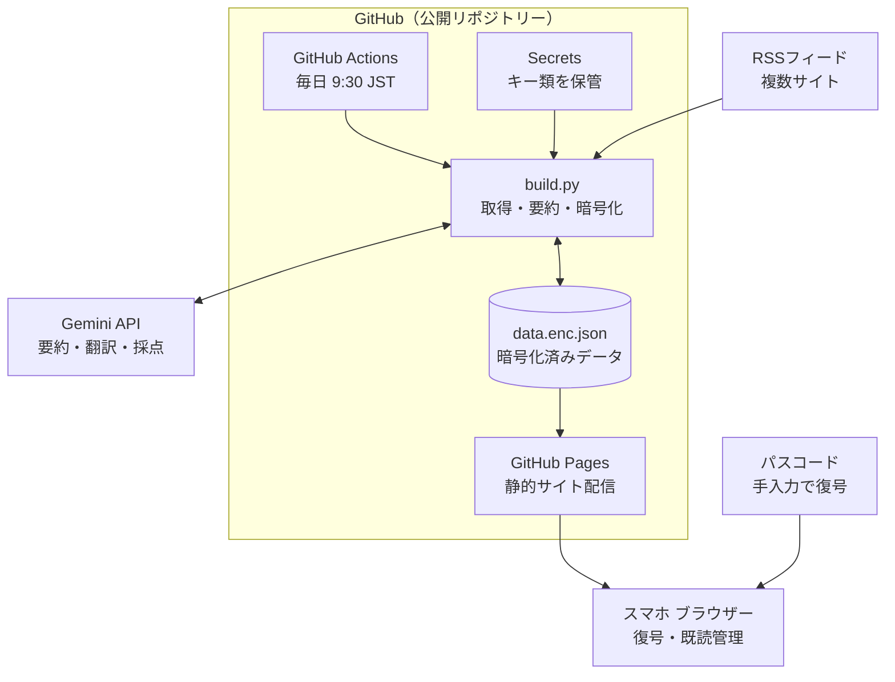

# 構築手順書: AI News Digest

完全無料で運用する「最新AIニュースまとめアプリ」の初期構築手順です。設計判断、システム構成図、コード、作業手順、運用上の注意をまとめています。

> `docs/` は GitHub Pages で公開されるフォルダーです。この手順書は公開したくないため、リポジトリー直下に置いています。

## システム構成図



### データの流れ

| # | 処理 | 担当 |
|---|---|---|
| 1 | 毎日 9:30 JST(UTC 00:30)に起動 | GitHub Actions |
| 2 | RSS から新着記事を取得し、既存の `data.enc.json` を復号して重複を除外 | build.py |
| 3 | 10 件ずつ Gemini に送り、日本語要約・翻訳・星(1〜5)を取得 | build.py → Gemini API |
| 4 | 全記事を AES-GCM で再暗号化して `data.enc.json` に書き込み、コミット | build.py |
| 5 | `docs/` を GitHub Pages にデプロイ | GitHub Actions |
| 6 | スマホでパスコードを入力すると、ブラウザー内で復号して表示。既読は localStorage に保存 | ブラウザー |

- Secrets(`GEMINI_API_KEY` と `APP_PASSCODE`)は Actions 内でのみ参照され、公開リポジトリーには含まれません。
- 公開されるのは暗号文のみです。パスコードを持たない第三者は記事内容を読めません。

## 1. 設計上の重要事項

`[仮定: リポジトリーは Public / 既読状態は端末ごと(localStorage) / 要約の入力は RSS のタイトル+概要文 / Python 3.12]`

GitHub Free の個人アカウントで使える Pages は公開リポジトリー向けで、Pages を非公開で公開するには Organization アカウントが必要です。そのため、サイトとリポジトリーは公開前提です。パスワード判定だけの JS では、データ(平文 JSON)が丸見えになります。そこで **データ自体を暗号化してコミット**し、パスコードを持つ端末でのみ復号できるようにします。

| 項目 | 採用 | 却下した代替案と理由 |
|---|---|---|
| 認証 | 暗号化 JSON + Web Crypto 復号 | JS でのパスワード照合(データが平文公開)/ Cloudflare Access 等(追加サービス・設定が増える)/ Private リポジトリー(無料プランでは Pages 不可) |
| 状態保存 | 暗号化 JSON をリポジトリーにコミット(過去記事を保持し重複排除) | 外部 DB(サーバーレス・無料の制約に反する) |
| 要約 | 10 件ずつ 1 リクエストでまとめて処理 | 記事ごとの呼び出し(レート制限に当たりやすい) |
| 本文 | RSS の概要文のみ使用 | 本文スクレイピング(サイト規約・失敗率の問題) |
| 既読管理 | localStorage | サーバー同期(無料・サーバーレスでは実装が重い) |
| デプロイ | `deploy-pages`(Actions 方式) | ブランチ配信(Actions のコミットで Pages が再ビルドされるか [要確認]) |

注意点:

- **パスコードは 12 文字以上のランダム文字列にしてください。** 暗号文は公開されるため、弱いパスコードはオフライン総当たりで破られます。
- Gemini の無料枠では、入出力が Google の製品改善に利用される場合があります。公開ニュースのみを扱うため問題ありませんが、機密データは入れないでください。
- 無料枠の上限値は出典間で不一致です([要確認])。ある出典では Flash 系プレビューが 10 RPM / 500 RPD、別の出典では Flash が約 15 RPM / 1,500 RPD とされています。本設計は 1 日 3〜4 リクエスト程度なので、どちらの数値でも収まります。
- モデル ID は出典間で表記が揺れているため **[要確認]** です。`config.yml` の `model` は初期値 `gemini-2.5-flash` を置いています。有効な ID は「4. 作業手順」の確認コマンドで一覧できます。

## 2. ディレクトリー構成

```
ai-news/
├─ .github/workflows/update.yml
├─ config.yml
├─ requirements.txt
├─ scripts/build.py
└─ docs/
   ├─ index.html
   └─ data.enc.json    ← 自動生成(初回実行で作られる)
```

## 3. コード

### `requirements.txt`

```
feedparser
pyyaml
cryptography
google-genai
```

初回成功後に `pip freeze` でバージョン固定を推奨します。

### `config.yml`

```yaml
# 使用モデル（ID は要確認。確認コマンドは手順 6 を参照）
model: gemini-2.5-flash

# 取得対象フィード（URL は各サイトの RSS/Atom に置き換える）
feeds:
  - name: Example AI Blog
    url: https://example.com/feed.xml
  - name: Example Research
    url: https://example.com/research/rss.xml

max_age_hours: 48       # 公開から何時間以内の記事を対象にするか
per_feed_limit: 10      # 1 フィードあたりの最大取得件数
max_new_per_run: 30     # 1 回の実行で要約する最大件数
batch_size: 10          # 1 リクエストで要約する件数
retention_days: 14      # 保持日数
```

### `scripts/build.py`

```python
"""AIニュースの取得・要約・暗号化スクリプト"""
import base64
import hashlib
import json
import os
import re
import sys
import time
from datetime import datetime, timedelta, timezone
from pathlib import Path

import feedparser
import yaml
from cryptography.exceptions import InvalidTag
from cryptography.hazmat.primitives import hashes
from cryptography.hazmat.primitives.ciphers.aead import AESGCM
from cryptography.hazmat.primitives.kdf.pbkdf2 import PBKDF2HMAC
from google import genai
from google.genai import types

ROOT = Path(__file__).resolve().parent.parent
CONFIG_PATH = ROOT / "config.yml"
DATA_PATH = ROOT / "docs" / "data.enc.json"
PBKDF2_ITERATIONS = 600_000  # index.html 側は data.enc.json の iter を参照する

PROMPT = """あなたはAI分野のニュース編集者です。
以下のJSON配列の各記事について、日本語で次の項目を持つJSON配列だけを返してください。
- id: 入力のidをそのまま返す
- title_ja: 日本語タイトル（40字以内）
- summary_ja: 日本語要約（2〜3文、140字以内。固有名詞は原語のまま。入力にない情報は書かない）
- stars: 注目度（1〜5の整数）

注目度の基準:
5=業界全体に影響する発表（主要モデル・規制・大型提携）
4=主要企業の新製品・重要な研究成果
3=実務に役立つ技術情報・ツール更新
2=小規模な更新・解説記事
1=宣伝色が強い・重要度が低い

入力:
__ARTICLES__
"""


def b64e(data: bytes) -> str:
    return base64.b64encode(data).decode("ascii")


def b64d(text: str) -> bytes:
    return base64.b64decode(text)


def derive_key(passcode: str, salt: bytes, iterations: int) -> bytes:
    """パスコードから AES-256 鍵を導出する"""
    kdf = PBKDF2HMAC(
        algorithm=hashes.SHA256(), length=32, salt=salt, iterations=iterations
    )
    return kdf.derive(passcode.encode("utf-8"))


def encrypt(obj: dict, passcode: str) -> dict:
    """辞書を AES-GCM で暗号化する（ct は 暗号文+タグ。Web Crypto と互換）"""
    salt = os.urandom(16)
    iv = os.urandom(12)
    key = derive_key(passcode, salt, PBKDF2_ITERATIONS)
    plain = json.dumps(obj, ensure_ascii=False).encode("utf-8")
    ct = AESGCM(key).encrypt(iv, plain, None)
    return {
        "v": 1,
        "iter": PBKDF2_ITERATIONS,
        "salt": b64e(salt),
        "iv": b64e(iv),
        "ct": b64e(ct),
    }


def decrypt(payload: dict, passcode: str) -> dict:
    key = derive_key(passcode, b64d(payload["salt"]), int(payload["iter"]))
    plain = AESGCM(key).decrypt(b64d(payload["iv"]), b64d(payload["ct"]), None)
    return json.loads(plain.decode("utf-8"))


def load_state(passcode: str) -> dict:
    """既存の暗号化データを復号して読み込む（初回は空）"""
    if not DATA_PATH.exists():
        return {"articles": []}
    try:
        payload = json.loads(DATA_PATH.read_text(encoding="utf-8"))
        return decrypt(payload, passcode)
    except InvalidTag:
        sys.exit(
            "復号に失敗しました。APP_PASSCODE を変更した場合は "
            "docs/data.enc.json を削除して再実行してください。"
        )


def fetch_new_articles(cfg: dict, seen_ids: set) -> list:
    """RSS から未取得の記事を集める"""
    now = datetime.now(timezone.utc)
    cutoff = now - timedelta(hours=cfg.get("max_age_hours", 48))
    found = {}
    for feed in cfg["feeds"]:
        parsed = feedparser.parse(feed["url"], agent="ai-news-bot/1.0")
        if not parsed.entries:
            print(f"[警告] 記事なし/取得失敗: {feed['name']}")
            continue
        for entry in parsed.entries[: cfg.get("per_feed_limit", 10)]:
            url = entry.get("link")
            if not url:
                continue
            aid = hashlib.sha1(url.encode("utf-8")).hexdigest()[:16]
            if aid in seen_ids or aid in found:
                continue
            ts = entry.get("published_parsed") or entry.get("updated_parsed")
            published = datetime(*ts[:6], tzinfo=timezone.utc) if ts else now
            if published < cutoff:
                continue
            text = re.sub(r"<[^>]+>", " ", entry.get("summary", ""))
            text = re.sub(r"\s+", " ", text).strip()[:1000]
            found[aid] = {
                "id": aid,
                "url": url,
                "source": feed["name"],
                "title": entry.get("title", "(no title)"),
                "text": text,
                "published": published.isoformat(),
            }
    articles = sorted(found.values(), key=lambda a: a["published"], reverse=True)
    return articles[: cfg.get("max_new_per_run", 30)]


def summarize_batch(client, model: str, batch: list) -> dict:
    """記事のまとまりを 1 リクエストで要約・翻訳・採点する。失敗時は空辞書"""
    payload = [
        {"id": a["id"], "title": a["title"], "text": a["text"], "source": a["source"]}
        for a in batch
    ]
    prompt = PROMPT.replace("__ARTICLES__", json.dumps(payload, ensure_ascii=False))
    for attempt in range(4):
        try:
            resp = client.models.generate_content(
                model=model,
                contents=prompt,
                config=types.GenerateContentConfig(
                    response_mime_type="application/json", temperature=0.2
                ),
            )
            items = json.loads(resp.text)
            return {i["id"]: i for i in items if isinstance(i, dict) and "id" in i}
        except Exception as exc:  # 429・JSON不正などを含めて再試行する
            wait = 20 * (attempt + 1)
            print(f"[警告] 要約失敗({attempt + 1}/4): {exc} → {wait}秒待機")
            time.sleep(wait)
    return {}


def main() -> None:
    api_key = os.environ.get("GEMINI_API_KEY")
    passcode = os.environ.get("APP_PASSCODE")
    if not api_key or not passcode:
        sys.exit("環境変数 GEMINI_API_KEY / APP_PASSCODE が未設定です。")

    cfg = yaml.safe_load(CONFIG_PATH.read_text(encoding="utf-8"))
    state = load_state(passcode)
    articles = state.get("articles", [])
    seen = {a["id"] for a in articles}

    new_items = fetch_new_articles(cfg, seen)
    print(f"新規候補: {len(new_items)} 件")
    if not new_items:
        print("新規記事なし。data.enc.json は更新しません。")
        return

    client = genai.Client(api_key=api_key)
    size = cfg.get("batch_size", 10)
    added = 0
    for i in range(0, len(new_items), size):
        chunk = new_items[i : i + size]
        result = summarize_batch(client, cfg["model"], chunk)
        for a in chunk:
            r = result.get(a["id"])
            if not r:
                continue  # 保存しない → 次回実行で再試行される
            try:
                stars = max(1, min(5, int(r.get("stars", 3))))
            except (TypeError, ValueError):
                stars = 3
            articles.append(
                {
                    "id": a["id"],
                    "url": a["url"],
                    "source": a["source"],
                    "title": str(r.get("title_ja") or a["title"]),
                    "summary": str(r.get("summary_ja") or ""),
                    "stars": stars,
                    "published": a["published"],
                }
            )
            added += 1
        time.sleep(5)  # RPM 対策の間隔

    if added == 0:
        print("要約に成功した記事がありません。data.enc.json は更新しません。")
        return

    keep_from = datetime.now(timezone.utc) - timedelta(days=cfg.get("retention_days", 14))
    articles = [a for a in articles if a["published"] >= keep_from.isoformat()]
    articles.sort(key=lambda a: a["published"], reverse=True)

    out = {
        "updated": datetime.now(timezone.utc).isoformat(),
        "articles": articles,
    }
    DATA_PATH.parent.mkdir(parents=True, exist_ok=True)
    DATA_PATH.write_text(json.dumps(encrypt(out, passcode)), encoding="utf-8")
    print(f"追加: {added} 件 / 保持合計: {len(articles)} 件")


if __name__ == "__main__":
    main()
```

### `docs/index.html`

```html
<!doctype html>
<html lang="ja">
<head>
<meta charset="utf-8">
<meta name="viewport" content="width=device-width, initial-scale=1">
<meta name="robots" content="noindex, nofollow">
<meta name="color-scheme" content="light dark">
<title>AI News</title>
<style>
:root{--bg:#f6f7f9;--fg:#1a1c20;--sub:#667085;--card:#fff;--line:#e4e7ec;--accent:#2563eb;--star:#f59e0b}
@media (prefers-color-scheme:dark){:root{--bg:#101114;--fg:#e8eaed;--sub:#9aa0a6;--card:#1a1c20;--line:#2b2e34;--accent:#6ea8fe;--star:#fbbf24}}
*{box-sizing:border-box}
body{margin:0;background:var(--bg);color:var(--fg);font:16px/1.6 system-ui,-apple-system,"Noto Sans JP",sans-serif}
[hidden]{display:none!important}
#lock{min-height:100vh;display:grid;place-items:center;padding:16px}
#form{width:100%;max-width:360px;display:grid;gap:12px}
#form h1{margin:0;font-size:22px}
input[type=password]{width:100%;padding:12px;font-size:16px;border:1px solid var(--line);border-radius:8px;background:var(--card);color:var(--fg)}
button{padding:10px 14px;font-size:15px;border:0;border-radius:8px;background:var(--accent);color:#fff}
button.ghost{background:transparent;color:var(--accent);border:1px solid var(--line)}
#err{color:#d92d20;margin:0;min-height:1.4em;font-size:14px}
header{position:sticky;top:0;z-index:1;background:var(--bg);border-bottom:1px solid var(--line);padding:8px 12px}
nav{display:flex;gap:8px;align-items:center;flex-wrap:wrap}
nav button.tab{background:transparent;color:var(--fg);border:1px solid var(--line);padding:6px 12px}
nav button.tab[aria-pressed=true]{background:var(--accent);color:#fff;border-color:var(--accent)}
#meta{font-size:12px;color:var(--sub);margin-top:4px}
ul{list-style:none;margin:0;padding:12px;display:grid;gap:10px}
li{background:var(--card);border:1px solid var(--line);border-radius:10px;padding:12px}
li.read{opacity:.55}
.row{display:flex;justify-content:space-between;gap:8px;font-size:12px;color:var(--sub)}
.stars{color:var(--star);letter-spacing:1px}
li a{display:block;margin:4px 0;font-weight:600;color:var(--fg);text-decoration:none}
li p{margin:4px 0 8px;font-size:14px}
li button{padding:4px 10px;font-size:12px}
#empty{padding:24px;text-align:center;color:var(--sub)}
</style>
</head>
<body>
<main id="lock">
  <form id="form">
    <h1>AI News</h1>
    <input id="pass" type="password" placeholder="パスコード" autocomplete="current-password" required>
    <label><input id="remember" type="checkbox"> この端末で記憶する</label>
    <button type="submit">開く</button>
    <p id="err" role="alert"></p>
  </form>
</main>
<div id="app" hidden>
  <header>
    <nav>
      <button class="tab" data-tab="unread" aria-pressed="true">未読</button>
      <button class="tab" data-tab="read" aria-pressed="false">既読</button>
      <button class="tab" data-tab="all" aria-pressed="false">すべて</button>
      <button class="ghost" id="markAll">表示中を既読に</button>
    </nav>
    <div id="meta"></div>
  </header>
  <ul id="list"></ul>
  <div id="empty" hidden>該当する記事はありません</div>
</div>
<script>
"use strict";
const READ_KEY = "ai-news-read";
const PASS_KEY = "ai-news-pass";
const $ = (s) => document.querySelector(s);
const b64d = (s) => Uint8Array.from(atob(s), (c) => c.charCodeAt(0));

// 暗号化データの復号（PBKDF2-SHA256 → AES-GCM）
async function decryptPayload(p, passcode) {
  const base = await crypto.subtle.importKey(
    "raw", new TextEncoder().encode(passcode), "PBKDF2", false, ["deriveKey"]);
  const key = await crypto.subtle.deriveKey(
    { name: "PBKDF2", salt: b64d(p.salt), iterations: p.iter, hash: "SHA-256" },
    base, { name: "AES-GCM", length: 256 }, false, ["decrypt"]);
  const buf = await crypto.subtle.decrypt({ name: "AES-GCM", iv: b64d(p.iv) }, key, b64d(p.ct));
  return JSON.parse(new TextDecoder().decode(buf));
}

// 既読状態（localStorage）
function loadRead() {
  try { return new Set(JSON.parse(localStorage.getItem(READ_KEY) || "[]")); }
  catch (e) { return new Set(); }
}
function saveRead(set) {
  try { localStorage.setItem(READ_KEY, JSON.stringify([...set])); } catch (e) { /* 保存不可は無視 */ }
}

let articles = [];
let readSet = loadRead();
let tab = "unread";

function visibleArticles() {
  return articles.filter((a) =>
    tab === "all" ? true : tab === "read" ? readSet.has(a.id) : !readSet.has(a.id));
}

function render() {
  const list = $("#list");
  list.replaceChildren();
  const items = visibleArticles();
  $("#empty").hidden = items.length > 0;
  for (const a of items) {
    const li = document.createElement("li");
    if (readSet.has(a.id)) li.className = "read";

    const row = document.createElement("div");
    row.className = "row";
    const stars = document.createElement("span");
    stars.className = "stars";
    stars.textContent = "★".repeat(a.stars) + "☆".repeat(5 - a.stars);
    const info = document.createElement("span");
    const d = new Date(a.published).toLocaleString("ja-JP",
      { month: "numeric", day: "numeric", hour: "2-digit", minute: "2-digit" });
    info.textContent = a.source + " / " + d;
    row.append(stars, info);

    const link = document.createElement("a");
    link.textContent = a.title;
    if (/^https?:\/\//.test(a.url)) {
      link.href = a.url;
      link.target = "_blank";
      link.rel = "noopener noreferrer";
    }
    // リンクを開いたら既読にする（再描画はしない）
    link.addEventListener("click", () => {
      readSet.add(a.id); saveRead(readSet); li.classList.add("read");
    });

    const p = document.createElement("p");
    p.textContent = a.summary;

    const btn = document.createElement("button");
    btn.className = "ghost";
    btn.textContent = readSet.has(a.id) ? "未読に戻す" : "既読にする";
    btn.addEventListener("click", () => {
      if (readSet.has(a.id)) readSet.delete(a.id); else readSet.add(a.id);
      saveRead(readSet); render();
    });

    li.append(row, link, p, btn);
    list.append(li);
  }
}

async function unlock(passcode, remember) {
  const res = await fetch("data.enc.json", { cache: "no-store" });
  if (!res.ok) throw new Error("data");
  const data = await decryptPayload(await res.json(), passcode);
  articles = data.articles;
  // 保持期間外の既読IDを掃除する
  const ids = new Set(articles.map((a) => a.id));
  readSet = new Set([...readSet].filter((id) => ids.has(id)));
  saveRead(readSet);
  if (remember) { try { localStorage.setItem(PASS_KEY, passcode); } catch (e) { /* 無視 */ } }
  $("#meta").textContent = "更新: " + new Date(data.updated).toLocaleString("ja-JP");
  $("#lock").hidden = true;
  $("#app").hidden = false;
  render();
}

$("#form").addEventListener("submit", async (ev) => {
  ev.preventDefault();
  $("#err").textContent = "";
  try {
    await unlock($("#pass").value, $("#remember").checked);
  } catch (e) {
    $("#err").textContent = "パスコードが違うか、データを取得できません。";
  }
});

document.querySelectorAll(".tab").forEach((b) =>
  b.addEventListener("click", () => {
    tab = b.dataset.tab;
    document.querySelectorAll(".tab").forEach((x) =>
      x.setAttribute("aria-pressed", String(x === b)));
    render();
  }));

$("#markAll").addEventListener("click", () => {
  visibleArticles().forEach((a) => readSet.add(a.id));
  saveRead(readSet); render();
});

// 記憶済みパスコードで自動ログイン
(async () => {
  let saved = null;
  try { saved = localStorage.getItem(PASS_KEY); } catch (e) { /* 無視 */ }
  if (saved) {
    try { await unlock(saved, false); }
    catch (e) { try { localStorage.removeItem(PASS_KEY); } catch (e2) { /* 無視 */ } }
  }
})();
</script>
</body>
</html>
```

### `.github/workflows/update.yml`

```yaml
name: update-news

on:
  schedule:
    - cron: "30 0 * * *"   # UTC 00:30 = JST 09:30
  workflow_dispatch:

permissions:
  contents: write
  pages: write
  id-token: write

concurrency:
  group: pages
  cancel-in-progress: false

jobs:
  build-deploy:
    runs-on: ubuntu-latest
    timeout-minutes: 20
    environment:
      name: github-pages
      url: ${{ steps.deployment.outputs.page_url }}
    steps:
      - uses: actions/checkout@v4

      - uses: actions/setup-python@v5
        with:
          python-version: "3.12"
          cache: pip

      - run: pip install -r requirements.txt

      - name: 記事取得・要約・暗号化
        env:
          GEMINI_API_KEY: ${{ secrets.GEMINI_API_KEY }}
          APP_PASSCODE: ${{ secrets.APP_PASSCODE }}
        run: python scripts/build.py

      - name: 状態をコミット
        run: |
          git config user.name "github-actions[bot]"
          git config user.email "41898282+github-actions[bot]@users.noreply.github.com"
          git add docs/data.enc.json
          if git diff --cached --quiet; then
            echo "変更なし"
          else
            git commit -m "chore: update news $(date -u +%F)"
            git push
          fi

      - uses: actions/configure-pages@v5

      - uses: actions/upload-pages-artifact@v3
        with:
          path: docs

      - id: deployment
        uses: actions/deploy-pages@v4
```

`[要確認]` 各 Action のメジャーバージョンは各リポジトリーの Releases で最新を確認してください。

## 4. 作業手順

| # | 作業 | 内容 |
|---|---|---|
| 1 | リポジトリー作成 | GitHub で **Public** リポジトリーを作成 |
| 2 | API キー取得 | Google AI Studio で Gemini API キーを発行 |
| 3 | Secrets 登録 | Settings → Secrets and variables → Actions に `GEMINI_API_KEY` と `APP_PASSCODE`(12 文字以上のランダム文字列)を登録 |
| 4 | ファイル配置 | 上記 5 ファイルを作成し、`config.yml` の `feeds` を実在する RSS URL に置換して push |
| 5 | Pages 設定 | Settings → Pages → Source を **GitHub Actions** に変更 |
| 6 | ローカル検証(任意) | 下記 PowerShell を実行 |
| 7 | 初回実行 | Actions → update-news → Run workflow で手動実行 |
| 8 | 閲覧 | `https://<ユーザー名>.github.io/<リポジトリー名>/` を Pixel 6a の Chrome で開き、パスコード入力後に「ホーム画面に追加」 |
| 9 | 定期実行の確認 | 翌日 9:30 JST 前後に実行履歴を確認 |

ローカル検証(Windows 11 / PowerShell):

```powershell
python -m venv .venv
.\.venv\Scripts\Activate.ps1
pip install -r requirements.txt
$env:GEMINI_API_KEY = "取得したキー"
$env:APP_PASSCODE = "決めたパスコード"
python scripts/build.py
python -m http.server 8000 --directory docs
# ブラウザーで http://localhost:8000 を開く
```

モデル ID の確認コマンド(`GEMINI_API_KEY` 設定済みの状態で実行):

```powershell
python -c "from google import genai; [print(m.name) for m in genai.Client().models.list()]"
```

## 5. 運用上の注意

- Actions の cron は UTC 基準で、混雑時は数分〜数十分遅れる場合があります。9:30 ちょうどの実行は保証されません。
- 公開リポジトリーでは、一定期間リポジトリー活動がないと定期実行が自動停止する仕様があります(期間・bot コミットが活動に含まれるかは **[要確認]**)。停止した場合は Actions 画面から再有効化してください。
- `APP_PASSCODE` を変更する場合は `docs/data.enc.json` を削除してから再実行してください(過去記事は消えます)。
- 既読状態は端末ごとです。PC と Pixel 6a では同期されません。
- RSS の URL は各サイトで確認してください。ここでは実在確認できない URL を載せていません。

[指摘: 「記憶する」を選ぶと、パスコードがその端末の localStorage に平文保存されます。紛失・共有端末では選択しないでください。]

## 参照元

- https://docs.github.com/ja/get-started/learning-about-github/githubs-plans
- https://geotoolbox.ai/blog/gemini-api-pricing.md
- https://dev.to/hiyoyok/gemini-api-cheatsheet-2026-free-tier-limits-models-and-endpoints-in-one-place-2god
- https://tinkerllm.com/blog/gemini-api-free-tier-limits-rate-quotas/
- https://ai.google.dev/gemini-api/docs/migrate?hl=en
