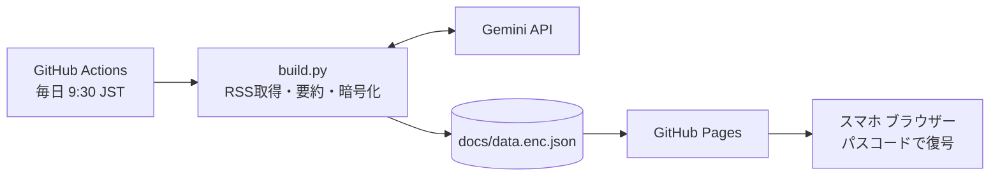

# AI News Digest

通勤中にスマホで読める、AI 系ニュースの自動要約アプリです。毎朝 9:30 (JST) に GitHub Actions が RSS を取得し、Gemini で日本語要約・注目度判定を行い、暗号化したデータを GitHub Pages で配信します。サーバー不要・追加費用なしで動作します。

## 特徴

| 項目 | 内容 |
|---|---|
| 完全無料 | GitHub Actions / GitHub Pages / Gemini API 無料枠のみで運用 |
| サーバーレス | PC の電源がオフでも毎朝自動更新 |
| AI 要約 | 複数 RSS の新着記事を日本語に翻訳・要約 |
| 注目度表示 | 星 1〜5 で可視化 |
| 既読管理 | 未読 / 既読 / すべて をタブで切り替え(端末ごとに保存) |
| 自分専用 | データを AES-GCM で暗号化。パスコードを知る人だけが閲覧可能 |
| スマホ最適化 | 軽量な HTML / CSS のみ。ダークモード対応 |

## 仕組み



詳細な構成図と設計判断は [DeploymentGuide.md](DeploymentGuide.md) を参照してください。

## 必要なもの

- GitHub アカウント(**Public** リポジトリーを作成できること)
- Google AI Studio で発行した Gemini API キー
- 12 文字以上のランダムなパスコード

## クイックスタート

1. Public リポジトリーを作成する。
2. Settings → Secrets and variables → Actions に次の 2 つを登録する。

   | Secret 名 | 内容 |
   |---|---|
   | `GEMINI_API_KEY` | Gemini API キー |
   | `APP_PASSCODE` | 閲覧用パスコード(12 文字以上のランダム文字列) |

3. `config.yml` の `feeds` を実在する RSS URL に書き換えて push する。
4. Settings → Pages → Source を **GitHub Actions** に設定する。
5. Actions → update-news → **Run workflow** で初回実行する。
6. `https://<ユーザー名>.github.io/<リポジトリー名>/` を開き、パスコードを入力する。

詳しい手順は [DeploymentGuide.md](DeploymentGuide.md) の「4. 作業手順」を参照してください。

## ディレクトリー構成

```
.
├─ .github/workflows/update.yml   # 毎朝 9:30 JST の自動実行
├─ config.yml                     # フィード・モデル・取得件数の設定
├─ requirements.txt
├─ scripts/build.py               # 取得・要約・暗号化
└─ docs/
   ├─ index.html                  # 閲覧画面(Pages で配信)
   ├─ manifest.json, sw.js, icon-*.png  # PWA(ホーム画面に追加・オフライン閲覧)
   └─ data.enc.json               # 暗号化データ(自動生成)
```

PWA: Service Worker は公開済みの静的ファイルと暗号化データだけをキャッシュします(平文・パスコードは含みません)。オンライン時は常に最新を取得し、失敗時のみキャッシュを使います。

## 設定 (`config.yml`)

| キー | 既定値 | 説明 |
|---|---|---|
| `model` | `gemini-2.5-flash` | 使用モデル。有効な ID は要確認 |
| `fallback_models` | `[]` | 主モデルが一時エラーで失敗し続けたときに順に試すモデル ID。未設定なら使わない |
| `feeds` | (要設定) | `name` と `url` のリスト |
| `max_age_hours` | 48 | 公開から何時間以内の記事を対象にするか。要約に失敗中の記事は `retention_days` の範囲で再試行する |
| `per_feed_limit` | 10 | 1 フィードあたりの最大取得件数 |
| `max_new_per_run` | 30 | 1 回の実行で要約する最大件数 |
| `batch_size` | 10 | 1 リクエストで要約する件数 |
| `retention_days` | 14 | 記事の保持日数 |
| `dedup_window_hours` | 72 | 同一ニュースの重複判定で、候補にする既出記事の期間(時間) |
| `max_summary_attempts` | 3 | 要約に失敗した記事を再試行する実行回数の上限。超えた記事は見送る |
| `interests` | (任意) | 関心領域のリスト。注目度の採点を補正する。空または削除で従来どおり |

有効なモデル ID の確認(`GEMINI_API_KEY` を設定した状態で実行):

```powershell
python -c "from google import genai; [print(m.name) for m in genai.Client().models.list()]"
```

## ローカル実行 (Windows 11 / PowerShell)

```powershell
python -m venv .venv
.\.venv\Scripts\Activate.ps1
pip install -r requirements.txt
$env:GEMINI_API_KEY = "取得したキー"
$env:APP_PASSCODE = "決めたパスコード"
python scripts/build.py
python -m http.server 8000 --directory docs
# ブラウザーで http://localhost:8000 を開く
```

## 運用上の注意

- Actions の cron は UTC 基準で、混雑時は数分〜数十分遅れることがあります。
- 公開リポジトリーでは、一定期間リポジトリー活動がないと定期実行が自動停止する仕様があります(期間・bot コミットが活動に含まれるかは要確認)。停止した場合は Actions 画面から再有効化してください。
- `APP_PASSCODE` を変更する場合は `docs/data.enc.json` を削除してから再実行してください(過去記事は消えます)。
- 既読状態は端末ごとです。PC とスマホでは同期されません。

## セキュリティー

- `docs/data.enc.json` の中身は、公開記事をもとにした URL・日本語タイトル・要約・星・日時のみです。API キーやパスコードは含まれません。
- 暗号文は公開されるため、弱いパスコードはオフライン総当たりで破られます。12 文字以上のランダム文字列を使用してください。
- `config.yml` は暗号化されないため、購読しているフィード一覧と `interests`(関心領域)は公開されます。
- 「この端末で記憶する」を選ぶと、パスコードが端末の localStorage に平文で保存されます。紛失・共有端末では選択しないでください。
- Gemini API の無料枠では、入出力が Google の製品改善に利用される場合があります。機密データは入れないでください。

## ライセンス

個人利用を想定しています。ライセンスは必要に応じて追加してください。
